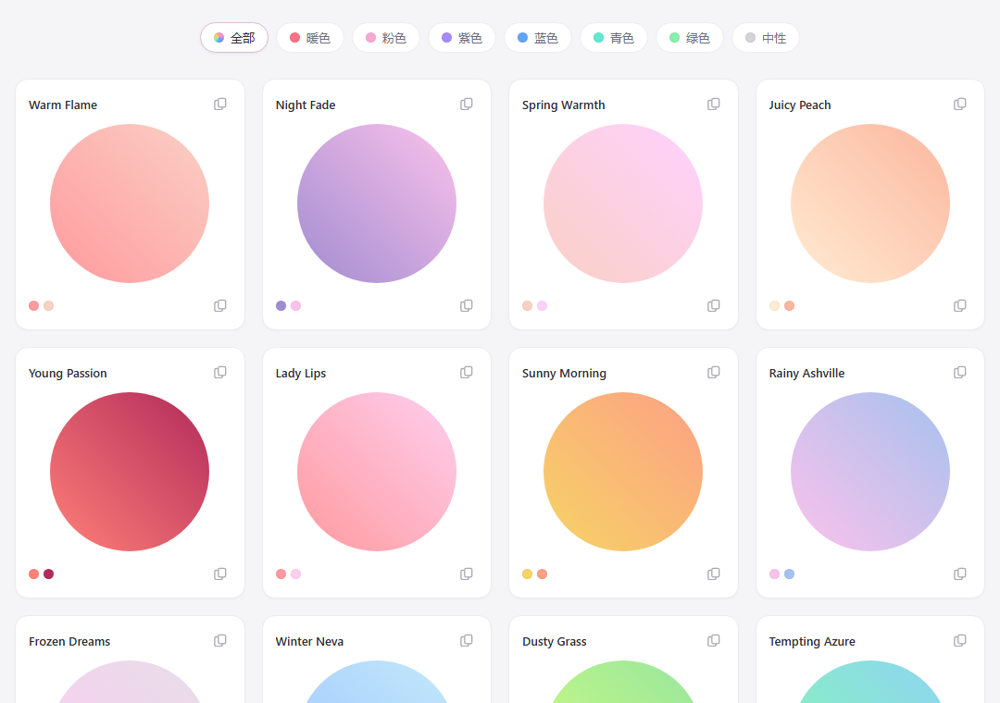
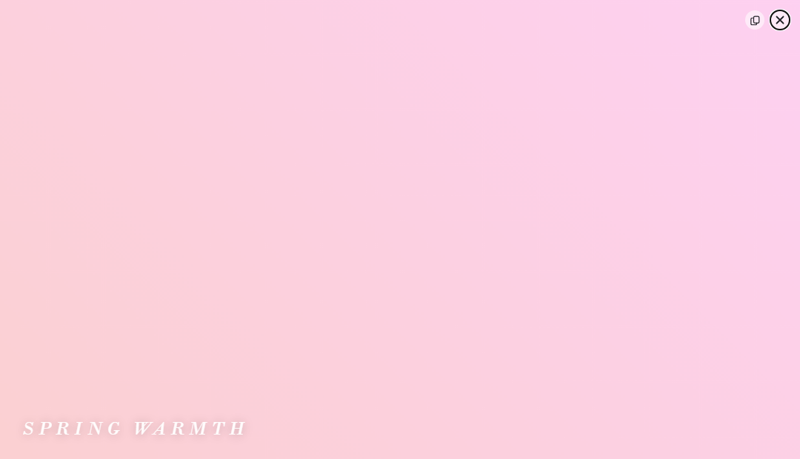
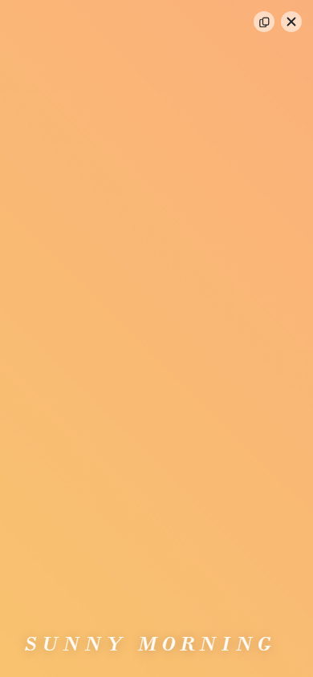
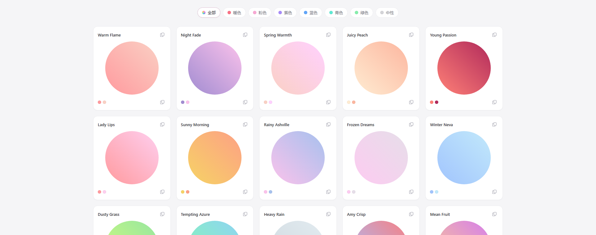

# 渐变色配色库

一个纯浏览器运行的 CSS 渐变配色展示工具，零后端依赖。



## 功能

- 浏览 46 组精选渐变配色
- 顶部居中色点筛选条（暖色 / 粉色 / 紫色 / 蓝色 / 青色 / 绿色 / 中性）
- 一键复制完整 CSS 渐变背景属性
- 下载单个渐变 CSS 或 JSON（悬停卡片时浮现下载按钮）
- 点击圆形色块全屏预览，再点或按 `Escape` 返回
- 响应式布局，支持 `prefers-reduced-motion: reduce`

## 快速开始

```bash
npm install
npm run dev
```

| 截图 | |
|---|---|
|  | 缩放动画终态，圆形铺满视口 |
|  | 移动端全屏预览 |
|  | 1920px 宽屏 5 列布局 |

## 全屏预览的缩放动画

点击色块后，被点击的那一块**本身就是动画主体**——它从自身几何中心放大铺满视口，
而不是切换到一个预先存在的全屏层，所以全程没有闪烁或跳变。

实现是 FLIP，拆成三块：

| 文件 | 职责 |
|---|---|
| `src/preview-animation.js` | 纯计算：`computeFlyerTransform` 算目标缩放与位移，`parseTransform` 读当前插值，`createPreviewController` 管状态机。全覆盖，不碰 DOM |
| `src/main.js` | DOM 侧：`placeFlyer` 定位与测量，`runScale` 用 Web Animations API 播放，状态机负责重入 |
| `src/style.css` | `.flyer` 的定位与 `transform-origin: 50% 50%`，动效常量 `--dur-*` / `--ease-*` |

关键点：

- **位移与缩放同时补间**。放大围绕色块中心，而色块通常偏离视口中心，
  所以放大后还要 `translate` 把圆拉回视口中心，两者一起补间。
- **动画主体是圆**。`.flyer` 带 `border-radius: 50%`，尺寸取卡片里的
  `.gradient-orb` 而非外层 `.gradient-preview`（后者是矩形容器，
  取错会把圆拉成椭圆）。
- **放大倍数按「圆心到最远角的距离」算，不是按视口最长边**。
  圆要盖住视口四角，半径必须 ≥ `hypot(圆心与视口中心的偏移) + 视口半对角线`。
  用 `max(视口宽, 视口高) / 2` 是**方形**的要求，对圆不够：1080×620 下圆心居中时
  按最长边算半径只有 550.8px，而到最远角需 622.7px，四角会露出灰底。
  实测三种视口（1080×620 / 1920×480 / 390×844）终态半径分别为四角需求的
  1.34× / 1.32× / 1.84×。
- **时长用 `--dur-fast`（160ms）而非 `--dur-slow`（320ms）**。圆要涨十倍
  尺寸，慢速下前 1/3 时间圆外都是灰底，看着像「没铺满」。实测未覆盖时长
  从 110ms 压到 47ms。
- **`transform-origin` 保持 CSS 默认的 50% 50%**，即色块几何中心。
- **动画结束不 `cancel()`**。`fill: "forwards"` 写下的 transform 会随
  `cancel()` 一起清掉，flyer 会瞬间缩回原尺寸。收尾走 `settle()`：
  先把终态写进内联样式，再清动画。
- **可安全重入**。展开中重复点击被忽略；全屏态换配色时从当前实际
  `transform` 接着走，动画不中断；关闭动画与展开严格互逆。
- **reduced-motion 下完全跳过 WAAPI 动画**，直接落位。

验证脚本：`node e2e-zoom.mjs`（覆盖上述各项，含重入与 reduced-motion）。
脚本依赖 playwright，但它不是本项目的依赖——用之前先装：

```bash
npm i -D playwright && npx playwright install chromium
```

然后先 `npm run dev` 起服务，再另开终端跑脚本。可用 `PREVIEW_URL` 环境变量
覆盖默认的 `http://localhost:5173/`。

> 调试这类「动画看着没铺满」的问题，别只看终态——终态永远是对的。
> 要用 `requestAnimationFrame` 高频采样每一帧的 `getBoundingClientRect()`，
> 才能看出前段有多少帧没覆盖。

> 覆盖判据要**逐个检查视口四角到圆心的距离是否 ≤ 半径**。
> 只比对圆的外接矩形（`scale × 宽 ≥ 视口宽` 且 `scale × 高 ≥ 视口高`）会漏判：
> 矩形包住了视口，圆却没包住四角。

## 开发

```powershell
npm install --ignore-scripts
npm run dev
```

> 沙箱环境下 esbuild 的 postinstall 会报 `EBUSY`，用 `--ignore-scripts` 安装即可。
> 若缺少平台二进制，补装 `npm i -D @esbuild/win32-x64`。
> npm scripts 已内置 `--configLoader runner`，绕开 esbuild 读取配置时的权限问题。

## 测试

```bash
npm test
```

47 个单测（3 个文件），其中 36 个专测缩放动画的几何计算与状态机。

## 构建

```bash
npm run build
```

产物 `dist/` 约 24 KB（JS 17 KB → gzip 5.5 KB；CSS 6.9 KB → gzip 2.3 KB），无运行时依赖。

## 项目结构

```
src/
  gradients.js            46 组渐变数据 + 分类元信息
  ui.js                   渲染筛选条与卡片
  export.js               CSS / JSON 导出
  main.js                 DOM 与事件编排、缩放动画播放
  preview-animation.js    纯计算：几何 + 状态机（零 DOM，可单测）
  style.css               浅色主题与动效常量
tests/                    vitest 单测
screenshots/              README 与笔记用的界面截图
e2e-check.mjs             常规交互验证
e2e-zoom.mjs              缩放动画九项验证
```

> `preview-animation.js` 刻意做成零 DOM 的纯计算模块——几何公式是这个项目最容易
> 出错的部分（详见上文「圆心到最远角」那条），脱离 DOM 才能用普通单测覆盖。

## License

MIT
